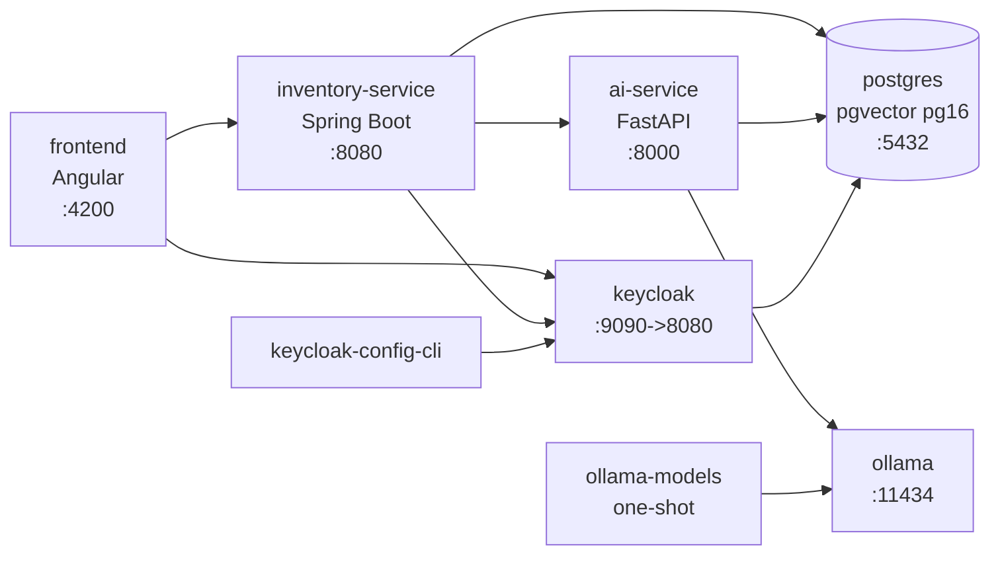

# Arquitectura de Contenedores

## Visión general

Toda la plataforma se ejecuta con Docker Compose (`docker-compose.yml`) sobre la red `neuroinventory-net`.



## Servicios

| Servicio | Imagen / Dockerfile | Puerto | Descripción |
| --- | --- | --- | --- |
| `postgres` | `pgvector/pgvector:pg16` | `${POSTGRES_PORT}:5432` | Base de datos relacional y vectorial. |
| `keycloak` | `quay.io/keycloak/keycloak:${KEYCLOAK_VERSION}` | `${KEYCLOAK_PORT}:8080` | Proveedor de identidad (start-dev). |
| `keycloak-config-cli` | `adorsys/keycloak-config-cli` | — | Importa el realm desde `config/realm.json`. |
| `ollama` | `ollama/ollama:${OLLAMA_VERSION}` | `${OLLAMA_PORT}:11434` | LLM local con reserva de GPU NVIDIA. |
| `ollama-models` | `ollama/ollama:${OLLAMA_VERSION}` | — | Descarga idempotente de modelos al volumen. Termina al acabar. |
| `ai-service` | `./ai-service/Dockerfile` | `${AI_SERVICE_PORT}:8000` | API de IA (FastAPI). |
| `inventory-service` | `./inventory-service/Dockerfile` | `${INVENTORY_SERVICE_PORT}:8080` | API principal (Spring Boot). |
| `frontend` | `./frontend/Dockerfile` (target `dev`) | `${FRONTEND_PORT}:4200` | Aplicación web Angular con `ng serve`. |

## Volúmenes

| Volumen | Servicio | Contenido |
| --- | --- | --- |
| `postgres_data` | postgres | Datos de la base de datos. |
| `ollama_data` | ollama | Modelos descargados (persisten entre rebuilds). |

## Imágenes

Todas las imágenes de los servicios propios son multi-stage cuando aporta
ventaja:

| Imagen | Build | Runtime |
| --- | --- | --- |
| `ai-service` | Python + compiladores y `venv` | Python slim + `libpq5`, usuario `app`. |
| `inventory-service` | JDK 21 + Gradle con caché BuildKit | JRE 21 Alpine, usuario `app`. |
| `frontend` | Node 24 + `npm ci` + `ng build` | Nginx Alpine con fallback SPA y caché de assets. |
| `mcp-server` | — | Python slim, usuario `app`. |

Buenas prácticas aplicadas:

- `.dockerignore` por servicio para no enviar `.venv`, `node_modules`, tests,
  reportes ni secretos al contexto de build.
- Usuario sin privilegios (`app`) en los servicios Python y Java.
- Healthchecks propios en las imágenes y `depends_on` con
  `condition: service_healthy` para ordenar el arranque.
- `restart: unless-stopped`, `init: true`, límites de memoria por servicio y
  límites de logs (`json-file` con rotación) para evitar contenedores zombis,
  consumos descontrolados y discos llenos.
- Ollama usa la imagen oficial y descarga los modelos en un volumen, en lugar
  de hornearlos en una imagen de varios GB.
- El frontend mantiene el stage `dev` para Docker Compose y usa Nginx en el
  stage final para producción.

### Imagen de producción del frontend

```bash
docker build -t neuroinventory/frontend:prod ./frontend
docker run --rm -p 4200:80 neuroinventory/frontend:prod
```

## Notas

- `keycloak-config-cli` y las dependencias `depends_on` con `condition:
  service_healthy` garantizan el orden de arranque.
- El servicio `ollama` requiere `nvidia-container-toolkit` para usar la GPU
  (ver `deployment.md`). Sin GPU, elimina la sección `deploy.resources` o usa
  el perfil de CPU de Ollama.
