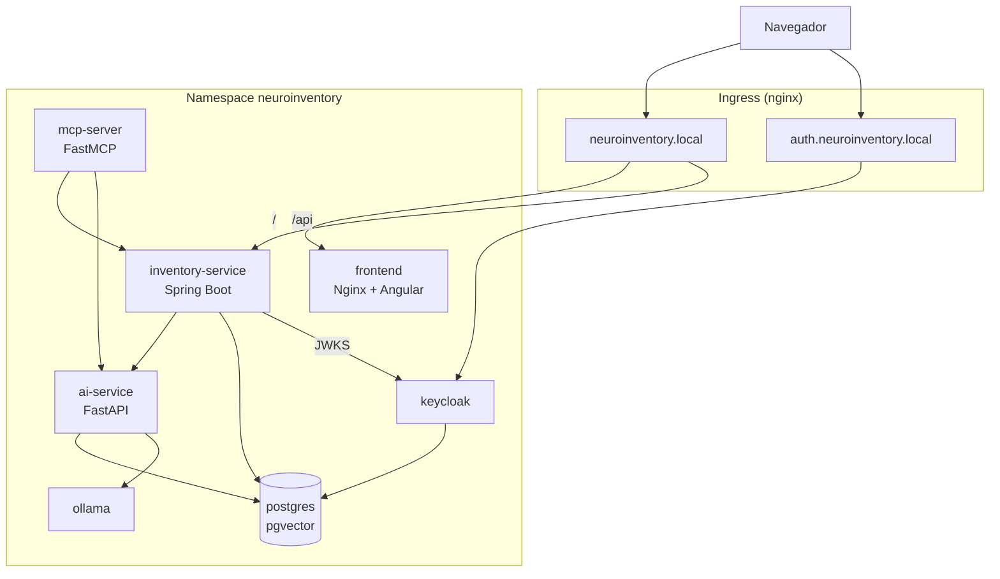

# Despliegue en Kubernetes (minikube)

La fase de Kubernetes despliega el mismo stack de servicios que Docker Compose
en un clúster local de minikube, con Ingress para publicar el frontend, la API y
Keycloak bajo nombres de host estables.

## Arquitectura



| Recurso | Tipo | Persistencia |
| --- | --- | --- |
| `postgres` | StatefulSet | PVC `data-postgres-0` (2 Gi) |
| `ollama` | Deployment (Recreate) | PVC `ollama-data` (8 Gi) |
| `keycloak` | Deployment (Recreate) | PostgreSQL |
| `inventory-service` | Deployment | — |
| `ai-service` | Deployment | PostgreSQL |
| `mcp-server` | Deployment | — |
| `frontend` | Deployment | `config.json` desde ConfigMap |
| `postgres-init` | Job | Crea bases y esquema |
| `ollama-models` | Job | Descarga los modelos |
| `keycloak-config` | Job | Importa el realm |

`keycloak` usa la estrategia `Recreate` porque Liquibase no admite dos pods
migrando el esquema a la vez. El resto de servicios pueden actualizarse con
rolling updates.

## Prerrequisitos

- Docker, `kubectl` y minikube.
- El addon `ingress` se habilita automáticamente con el script.
- Memoria recomendada para minikube: **12 GB** si se va a usar Ollama con
  `llama3.2`. El tamaño no se puede cambiar en un perfil existente: hay que
  recrearlo (esto borra los datos del clúster, no los del repositorio):

  ```bash
  minikube delete
  minikube start --memory=12288 --cpus=6
  ```

  El stack también arranca con los 8 GB por defecto, pero la inferencia local
  queda muy justa y Keycloak necesita ~2 GB solo durante su build de Quarkus
  (el Deployment tiene un límite de 3 Gi).

- Tras reiniciar el equipo basta con `minikube start` (sin flags): el perfil,
  las imágenes cargadas y los PVC se conservan.

## Acceso

`k8s-up.sh` añade automáticamente la entrada a `/etc/hosts` con la IP actual del
clúster, y `k8s-down.sh` la elimina. El helper también se puede usar solo:

```bash
./scripts/k8s-hosts.sh add      # añade o actualiza la entrada
./scripts/k8s-hosts.sh remove   # la elimina
./scripts/k8s-hosts.sh status   # muestra el estado actual
```

Escribe `/etc/hosts` a través del daemon de Docker (que corre como root), por lo
que no pide contraseña; si Docker no está disponible recurre a `sudo`. Es
idempotente: elimina entradas antiguas de esos nombres (por ejemplo si cambia la
IP de minikube) y no duplica líneas. Para no tocar el fichero:

```bash
SKIP_HOSTS=1 ./scripts/k8s-up.sh
```

| URL | Servicio |
| --- | --- |
| `http://neuroinventory.local` | Frontend Angular |
| `http://neuroinventory.local/api/v1/inventory-service` | API REST |
| `http://auth.neuroinventory.local` | Keycloak |
| `http://localhost:8001` (port-forward) | MCP Server |

La API y el frontend comparten origen (`/api`), por lo que no hay CORS entre
ambos. Keycloak vive en un host distinto para que el `issuer` de los tokens sea
estable y coincida con el que valida `inventory-service`.

## Despliegue

```bash
./scripts/k8s-up.sh           # construye lo que falte y despliega
./scripts/k8s-up.sh --build   # reconstruye y recarga todas las imágenes
```

El script:

1. Habilita el addon `ingress` y espera al controlador.
2. Construye las imágenes con los Dockerfiles de producción y las carga en
   minikube (`minikube image load`). También carga las imágenes de
   infraestructura que ya existan en el Docker del host.
3. Genera los ConfigMaps (`app-config`, `frontend-config`, `postgres-init`,
   `keycloak-realm`) y el Secret `neuroinventory-secrets` a partir de `.env`.
4. Despliega PostgreSQL, ejecuta el Job `postgres-init` y, cuando termina,
   aplica el resto de manifiestos.
5. Espera a los rollouts y añade la entrada a `/etc/hosts` (salvo
   `SKIP_HOSTS=1`) con la IP y los nombres de host configurados.
6. Muestra la IP y las URLs de acceso.

Con `--build` se reconstruyen las cuatro imágenes propias, se recargan en el
nodo y se reinician sus Deployments. Las imágenes conservan el tag `k8s`, así
que el script elimina el tag anterior del nodo antes de cargar la nueva: sin
ese paso minikube seguiría sirviendo la versión antigua aunque el build haya
terminado correctamente. Las imágenes de infraestructura no se recargan.

La descarga de modelos de Ollama puede tardar varios minutos. El script no
bloquea el despliegue esperándola:

```bash
kubectl -n neuroinventory get job ollama-models
kubectl -n neuroinventory logs job/ollama-models -f
```

Para cambiar los nombres de host:

```bash
FRONTEND_HOST=inventario.local KEYCLOAK_HOST=auth.inventario.local ./scripts/k8s-up.sh
```

El realm de Keycloak se transforma en el script: el valor `localhost:4200` de
`config/realm.json` se sustituye por `http://$FRONTEND_HOST`.

## Configuración runtime del frontend

La imagen de producción sirve `config.json` sin caché. Antes de inicializar
Keycloak, Angular carga ese fichero y sobreescribe `environment.ts`; si no
existe, mantiene los valores de desarrollo. En Kubernetes el ConfigMap
`frontend-config` monta el fichero en `/usr/share/nginx/html/config.json`:

```json
{
  "apiUrl": "/api/v1/inventory-service",
  "keycloakUrl": "http://auth.neuroinventory.local",
  "keycloakRealm": "neuroinventory",
  "keycloakClientId": "frontend-client"
}
```

Esto permite reutilizar la misma imagen sin recompilar el bundle al cambiar de
entorno.

## Operación

```bash
kubectl -n neuroinventory get pods
kubectl -n neuroinventory get jobs
kubectl -n neuroinventory logs deploy/keycloak -f
kubectl -n neuroinventory logs job/postgres-init
kubectl -n neuroinventory describe pod -l app=inventory-service

# Reaplicar cambios de manifiestos
kubectl apply -k deploy/k8s

# Volver a ejecutar la inicialización (idempotente)
kubectl -n neuroinventory delete job postgres-init keycloak-config ollama-models
kubectl apply -k deploy/k8s
```

Para eliminar el despliegue conservando los datos:

```bash
./scripts/k8s-down.sh
```

Para borrar también los PVC, el namespace y los datos:

```bash
./scripts/k8s-down.sh --purge
```

En ambos casos se elimina la entrada de `/etc/hosts` (salvo `SKIP_HOSTS=1`).

## Verificación

```bash
IP=$(minikube ip)

curl -s -o /dev/null -w '%{http_code}\n' -H 'Host: neuroinventory.local' "http://$IP/"
curl -s -H 'Host: neuroinventory.local' "http://$IP/config.json"
curl -s -o /dev/null -w '%{http_code}\n' \
  -H 'Host: neuroinventory.local' \
  "http://$IP/api/v1/inventory-service/actuator/health"

curl -s -H 'Host: auth.neuroinventory.local' \
  "http://$IP/realms/neuroinventory/.well-known/openid-configuration" \
  | python3 -c "import sys,json; print(json.load(sys.stdin)['issuer'])"
```

Prueba autenticada de extremo a extremo con el cliente de servicio del MCP:

```bash
TOKEN=$(curl -s -X POST -H 'Host: auth.neuroinventory.local' \
  -d 'grant_type=client_credentials&client_id=mcp-server-client&client_secret=mcp-server-secret' \
  "http://$IP/realms/neuroinventory/protocol/openid-connect/token" \
  | python3 -c "import sys,json; print(json.load(sys.stdin)['access_token'])")

curl -s -H 'Host: neuroinventory.local' -H "Authorization: Bearer $TOKEN" \
  "http://$IP/api/v1/inventory-service/products"
```

## Diferencias con Docker Compose

- **Base de datos de Keycloak**: en Kubernetes usa la base `keycloak`, creada
  por el Job `postgres-init`, en lugar de compartir `neuroinventory`.
- **Inicialización de esquema**: se hace en un Job idempotente, no en los
  scripts de entrada de PostgreSQL.
- **Ingress**: frontend y API comparten host; Keycloak usa un subdominio.
- **Frontend**: se usa la imagen de producción (Nginx), no `ng serve`.
- **Ollama**: se ejecuta en CPU. El driver Docker de minikube no expone la GPU
  por defecto; para usarla haría falta `minikube start --gpu=all` con
  `nvidia-container-toolkit` y añadir la sección de recursos GPU al Deployment.
- **Observabilidad**: los manifiestos de Prometheus, Grafana, Alertmanager y
  OpenTelemetry todavía no están incluidos en `deploy/k8s/`; el stack de
  observabilidad sigue disponible con `docker-compose.observability.yml`. El
  `ai-service` solo exporta trazas si se define
  `OTEL_EXPORTER_OTLP_TRACES_ENDPOINT`, así que en Kubernetes no genera
  reintentos contra un colector inexistente. Las métricas Prometheus siguen
  expuestas en `/metrics`.

## Solución de problemas

| Síntoma | Causa y solución |
| --- | --- |
| `kubectl` no encuentra el namespace | `./scripts/k8s-up.sh` crea el namespace antes de aplicar el resto. |
| El addon `ingress` tarda y el script falla | La primera vez descarga las imágenes del controlador; el script espera hasta 10 min. Reintenta si la red es lenta. |
| `keycloak` en `OOMKilled` | Necesita ~2 GB durante el build de Quarkus. El Deployment usa 3 Gi de límite y heap al 50 %. Si el nodo tiene menos memoria, recrea el perfil con `minikube delete && minikube start --memory=12288`. |
| `keycloak` reinicia durante el primer arranque | El build y las migraciones de Liquibase pueden superar varios minutos; el `startupProbe` tiene 10 min de margen. |
| `postgres` arranca sin la base `neuroinventory` | El esquema y las bases se crean en el Job `postgres-init`; revisa sus logs y vuelve a lanzarlo. |
| Los pods siguen con el código anterior tras un build | `minikube image load` no reemplaza un tag existente. Usa `./scripts/k8s-up.sh --build`, que elimina el tag del nodo y reinicia los Deployments. |
| `ImagePullBackOff` en las imágenes propias | Son imágenes locales sin registry: deben cargarse con el script. |
| Los modelos de Ollama no aparecen | El Job `ollama-models` descarga en segundo plano; consulta `kubectl -n neuroinventory logs job/ollama-models`. |
| El frontend usa `localhost` | El `config.json` del ConfigMap no se montó o hay caché del navegador. Comprueba `curl http://neuroinventory.local/config.json`. |

## Limitaciones

Este despliegue está pensado para desarrollo local y demostración:

- Un solo nodo, sin alta disponibilidad.
- Sin TLS ni cert-manager.
- Secretos creados desde `.env` como Secret de Kubernetes, sin cifrado en
  reposo ni integración con un gestor de secretos.
- Imágenes cargadas localmente; no hay registry ni pipeline de despliegue.
- Sin `metrics-server` ni HPA.

Para un entorno real habría que añadir registry, TLS, base de datos gestionada,
gestión de secretos, políticas de red, observabilidad y backups.
